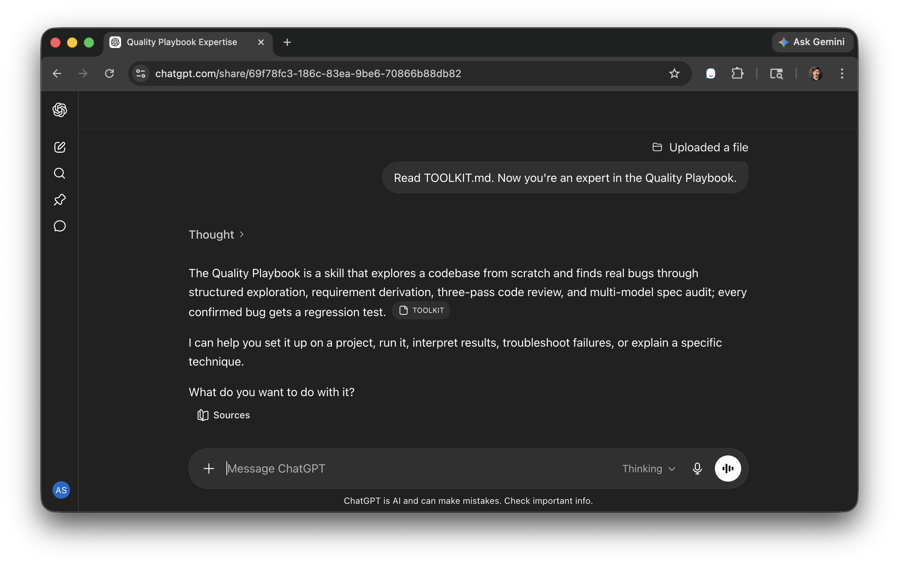

# Quality Playbook

**Version:** 1.6.1 | **Author:** [Andrew Stellman](https://github.com/andrewstellman) | **License:** Apache 2.0

**Find the bugs that code review misses**

Most code review looks at how the code is written. The Quality Playbook looks at what the code is supposed to do, and whether it does it.

The Quality Playbook explores your codebase and works out the behavioral requirements of your code from two sources: the code itself, and your documentation (specs, issues, chat history, post-mortems). Then it runs a three-pass code review and a multi-model spec audit (the Council of Three) against those requirements. The bugs it turns up are the ones that look correct to anyone who doesn't already know the spec:

- a function that silently returns null instead of throwing
- a duplicate-key check that passes when the first value is null
- sanitization that runs after the branch decision it was supposed to guard

It catches bugs that a thorough adversarial code-review prompt running on Claude Opus 4.8 misses. Along the way it also builds quality infrastructure that your project keeps, and every later review cycle runs against it:

- derived requirements
- functional and integration tests
- contracts and a coverage matrix
- the code-review, spec-audit, and TDD verification protocols themselves

*And this isn't theoretical! Maintainers have [merged fixes for 11 bugs](#merged-bugs-leaderboard) that the Quality Playbook found in the Linux kernel, Google's gson, aiohttp, calibre, OpenTelemetry and four other projects.*

## Quick start

**Install** into your project's root directory (pick one):

```bash
npx quality-playbook install --into . --ai-tool claude     # from npm, no global install
pip install quality-playbook && quality-playbook install --into . --ai-tool claude   # from pip
git clone https://github.com/andrewstellman/quality-playbook   # or clone and ask your AI to install it
```

Swap `claude` for `cursor`, `copilot`, `continue`, `codex`, `windsurf`, `cline`, or `aider`. You need Python 3.10 or later on your `PATH`.

**Run** by opening your project in your AI coding tool and telling the agent:

> *"Run the Quality Playbook on this project."*

The agent finds the installed skill on its own and runs the six phases (explore, generate, code review, spec audit, reconcile, verify), pausing after each one until you say "keep going". It writes the results into a `quality/` folder. Start with `quality/BUGS.md`, which lists the bugs it found.

<!-- TOKENS: pending benchmark run — replace with real input/output token usage from arunner recall runs, e.g. "A full baseline run against repos X / Y / Z cost N input / M output tokens." Do not invent numbers. -->

## Merged bugs leaderboard

As of 20 October 2026, maintainers have merged these 11 fixes, and 14 more fixes and reports are [submitted and waiting](#submitted-upstream). The full record, including the bugs that were held back, dropped or never filed, is in [`evidence/README.md`](evidence/README.md).

| Project | The bug | Fix | Merged | Evidence |
|---|---|---|---|---|
| Linux kernel, `virtio-pci` | `vp_interrupt()` returned `IRQ_NONE` for a config-change interrupt with no vring work, even though reading the ISR had already consumed it, so the kernel counted those interrupts as spurious | [`93fa0945`](https://git.kernel.org/pub/scm/linux/kernel/git/torvalds/linux.git/commit/?id=93fa09455fb1a9624b73d42ac1f83771f4818e80) | 2026-09-07 | [Evidence folder](evidence/virtio-pci-intx/), with the QEMU console logs |
| Linux kernel, `zram` | `recompress_store()` silently accepted an unrecognized `type=` value, leaving the pass with no slot filter so it recompressed every slot instead of the intended subset | [`2f529e73`](https://git.kernel.org/pub/scm/linux/kernel/git/torvalds/linux.git/commit/?id=2f529e73d72048743b6eaa241da6ac2bcb28099e) | 2026-04-18 | [Evidence folder](evidence/zram-recompress-unknown-type/) and the [patch thread](https://lore.kernel.org/20260407153027.42425-1-astellman@stellman-greene.com) |
| Google `gson` | gson silently accepted duplicate keys when the first value was `null` | [#3006](https://github.com/google/gson/pull/3006) | 2026-04-05 | [Evidence folder](evidence/gson-map-duplicate-null-key/) |
| aio-libs `aiohttp` | `StreamReader.readuntil()` missed a separator of two or more bytes when it was split across chunks, so it returned too much data or kept waiting | [#13870](https://github.com/aio-libs/aiohttp/pull/13870), backported to 3.15 and 3.14 | 2026-10-02 | [Evidence folder](evidence/aiohttp-readuntil-split-separator/) |
| `calibre` | The content server returned a 500 instead of a 404 for a malformed hex id in an OPDS feed URL | [#3310](https://github.com/kovidgoyal/calibre/pull/3310) | 2026-09-29 | [Evidence folder](evidence/calibre-opds-navcatalog/) |
| OpenTelemetry Java instrumentation | The `Forwarded` host extractor recorded "[2001" as the host for a bracketed IPv6 address | [#20393](https://github.com/open-telemetry/opentelemetry-java-instrumentation/pull/20393) | 2026-10-16 | [Evidence folder](evidence/otel-java-forwarded-host-ipv6/) |
| OpenTelemetry Java instrumentation | `UrlParser` recorded `server.address` as "[" for a bracketed IPv6 address | [#20320](https://github.com/open-telemetry/opentelemetry-java-instrumentation/pull/20320) | 2026-10-16 | [Evidence folder](evidence/otel-java-urlparser-ipv6/) |
| adonisjs `http-server` | The `uuid` route matcher accepted letters that are not hex digits | [#144](https://github.com/adonisjs/http-server/pull/144) | 2026-10-14 | [Evidence folder](evidence/adonis-uuid-matcher/) |
| python-poetry `tomlkit` | Arithmetic on a float written with an explicit sign wrote a negative-zero result as `+-0.0`, which tomlkit itself then rejected | [#629](https://github.com/python-poetry/tomlkit/pull/629) | 2026-10-12 | [Evidence folder](evidence/tomlkit-float-negative-zero-sign/) |
| harrisiirak `cron-parser` | String dates in the RFC 850 and asctime HTTP formats threw "unhandled timestamp", although cron-parser's README lists HTTP dates as supported | [#455](https://github.com/harrisiirak/cron-parser/pull/455) | 2026-10-11 | [Evidence folder](evidence/cron-parser-http-date-formats/) |
| bradymholt `cRonstrue` | A list with a plain first value and a step printed "At 09:00 AMonly on Friday and , every 2 days of the week" | [#423](https://github.com/bradymholt/cRonstrue/pull/423) | 2026-10-20 | [Evidence folder](evidence/cronstrue-list-step-separator/) |

*Open-source maintainers are drowning in AI-generated pull requests right now, and I have no intention of adding to that pile. The playbook's agents reproduced each of these bugs and drafted the patches, but before anything went upstream I read the code, ran the red and green tests myself, and checked their output against the finding. For the virtio bug that meant booting a patched kernel under QEMU. Every one of these fixes says in its pull request or commit message that AI was involved, except the zram patch, which went in before I started requiring that.*

*Every bug has a record in this repository, which the evidence column links to: the reproduction logs, the patch as sent, and (for all but virtio, zram and gson, which came before I added that step) the review that preceded submission. The gson and zram records are the raw run output, recovered from a backup after the fact; each folder's `NOTE.md` says what is and is not there.*

## Contents

- [Merged bugs leaderboard](#merged-bugs-leaderboard)
- [How to install the Quality Playbook](#how-to-install-the-quality-playbook)
- [How to run the Quality Playbook](#how-to-run-the-quality-playbook)
- [Example output](#example-output)
- [Need help? Just ask your AI](#need-help-just-ask-your-ai)
- [Running the playbook](#running-the-playbook)
- [What the playbook produces](#what-the-playbook-produces)
- [How it works](#how-it-works)
- [Want to learn more?](#want-to-learn-more)
- [Submitted upstream](#submitted-upstream)
- [Recent releases](#recent-releases)
- [Running across many repos with arunner](#running-across-many-repos-with-arunner)
- [Repository structure](#repository-structure)
- [How I improve the playbook](#how-i-improve-the-playbook)
- [Context](#context)
- [License](#license)
- [Patent notice](#patent-notice)

## How to install the Quality Playbook

**The fastest way to install is from npm or pip.** From your project's root directory, run one of these:

```bash
# From npm, no global install:
npx quality-playbook install --into . --ai-tool <tool>

# From pip / uvx / pipx (Python 3.10+):
uvx quality-playbook install --into . --ai-tool <tool>           # one-shot, no global install
pipx run quality-playbook install --into . --ai-tool <tool>
pip install quality-playbook && quality-playbook install --into . --ai-tool <tool>
```

`<tool>` is one of `claude`, `cursor`, `copilot`, `continue`, `codex`, `windsurf`, `cline`, or `aider`. The skill installs into `.<tool>/skills/quality-playbook/` (or `.github/skills/quality-playbook/` for `copilot`). These commands install it for Claude Code, Cursor and GitHub Copilot:

```bash
npx quality-playbook install --into . --ai-tool claude       # Claude Code
npx quality-playbook install --into . --ai-tool cursor       # Cursor
npx quality-playbook install --into . --ai-tool copilot      # GitHub Copilot
```

**You can also install the Quality Playbook (QPB) from the Claude Code plugin marketplace.** If you use Claude Code, the first command below adds the marketplace and the second installs QPB from it:

```
/plugin marketplace add https://github.com/andrewstellman/quality-playbook
/plugin install quality-playbook
```

Use the full `https://` URL, because the shorthand `github.com/...` form makes Claude Code attempt an SSH clone, which fails on machines without a GitHub SSH key configured.

After you install it this way, the agent finds the QPB skill in any project you open with Claude Code, so you don't need to run `quality-playbook install --into ...`. When a new QPB version ships, run `/plugin marketplace update` and then install it again.

To work from a local checkout of QPB (for example, to test a fork), use `--plugin-dir` instead of the marketplace:

```
claude --plugin-dir /path/to/quality-playbook/plugins/quality-playbook
```

The `--plugin-dir` argument takes an absolute path to the plugin directory inside the QPB clone, and it loads the plugin for that Claude Code session only.

**You can also ask your AI coding tool to install it from a clone of this repo.**

1. **Clone this repo** somewhere on your machine (for example, `git clone https://github.com/andrewstellman/quality-playbook ~/quality-playbook`). You can install into any number of projects from one clone.

2. **Open your target project** in Claude Code, Cursor, GitHub Copilot, Windsurf, Continue, or another AI coding tool.

3. **Ask the AI to install it.** You can say something like this:

   > *"Install the Quality Playbook into this project from `~/quality-playbook`."*

   The agent reads [`AGENTS.md`](AGENTS.md), figures out which install location your tool uses, and runs the installer.

If you'd rather install by hand or run the script yourself, load [`ai_context/TOOLKIT.md`](ai_context/TOOLKIT.md) into your AI tool (there's more about that file under [Need help?](#need-help-just-ask-your-ai) below) and ask it: *"Read TOOLKIT.md. How do I install the skill manually or via the `bin/install_skill.py` script directly?"*

**Prerequisite:** You need Python 3.10 or later on your `PATH`. The npm package is a thin shim over the same Python installer, so `npx` needs Python 3.10 too.

**The playbook finds more bugs when you give it documentation.** It reads written specs, design docs, GitHub or Jira issues from real users, chat history, and post-mortems, and from those it works out what your code is *supposed* to do. Without documentation it still runs from the source tree alone, but it finds fewer bugs. Put everything you have into a `reference_docs/` directory at the project root.

**One prompt gathers the documentation for you.** Copy [`references/DOC_GATHERING_PROMPT.md`](references/DOC_GATHERING_PROMPT.md) into your AI coding tool with your project open, and run it. The agent confirms which project you mean, then collects the project's docs, issues, and advisories into `reference_docs/`.

## How to run the Quality Playbook

Open your project in your AI coding tool (Claude Code, Cursor, GitHub Copilot, Windsurf, Continue, etc.) and tell the agent:

> *"Run the Quality Playbook on this project."*

That one line is enough, because once the skill is installed the agent finds it on its own; you don't have to open or point at `SKILL.md` or any other file. The agent runs the six phases, pausing after each one until you say *"keep going"*, and writes the results into a `quality/` folder in your project.

A full six-phase run takes a while and uses a lot of tokens. To spread it across sessions, for example to stay inside a daily token budget, tell the agent to run only some of the phases:

> *"Run phases 1 to 3 of the Quality Playbook on this project."*

Then, in a later session:

> *"Continue the Quality Playbook from phase 4."*

When the run finishes, the `quality/` folder contains:

```
quality/
├── BUGS.md                  ← consolidated bug report with spec basis (start here)
├── REQUIREMENTS.md          ← behavioral requirements derived from your code + docs
├── EXPLORATION.md           ← Phase 1 findings: patterns explored, files tagged
├── QUALITY.md               ← quality constitution for your codebase
├── CONTRACTS.md             ← extracted behavioral contracts
├── COVERAGE_MATRIX.md       ← contract-to-requirement traceability
├── COMPLETENESS_REPORT.md   ← final gate report with post-reconciliation verdict
├── PROGRESS.md              ← phase checkpoint log + cumulative bug tracker
├── test_functional.py       ← functional tests traced to requirements
├── test_regression.py       ← regression tests for confirmed bugs
├── writeups/                ← per-bug detailed writeups with patches (BUG-NNN.md)
├── patches/                 ← fix and regression-test patches
├── code_reviews/            ← three-pass code review output
├── spec_audits/             ← Council of Three auditor reports + triage
└── results/                 ← TDD red/green logs, integration results, gate log
```

Start with `BUGS.md` for the headline findings. Then read `REQUIREMENTS.md`, the playbook's account of what your code is supposed to do, which includes requirements it derived from issues and docs you may not have known about. The bugs it reports come from the gap between what `REQUIREMENTS.md` says and what your code does.

## Example output

The `quality/` directory in this repository contains the real output of running the playbook against its own code.

| File | What to look at |
|------|----------------|
| [REQUIREMENTS.md](quality/REQUIREMENTS.md) | Behavioral requirements derived from the skill specification. Every other file is built from these. |
| [QUALITY.md](quality/QUALITY.md) | Quality constitution defining fitness-to-purpose scenarios and coverage targets for the playbook itself. |
| [test_functional.py](quality/test_functional.py) | Functional tests traced to requirements, written in the project's native language. |
| [CONTRACTS.md](quality/CONTRACTS.md) | Raw behavioral contracts extracted from the codebase before requirement derivation. |
| [COVERAGE_MATRIX.md](quality/COVERAGE_MATRIX.md) | Traceability matrix mapping every contract to the requirement that covers it. |
| [COMPLETENESS_REPORT.md](quality/COMPLETENESS_REPORT.md) | Final gate report with post-reconciliation verdict. |
| [RUN_CODE_REVIEW.md](quality/RUN_CODE_REVIEW.md) | Three-pass code review protocol ready for any AI session to execute. |
| [RUN_SPEC_AUDIT.md](quality/RUN_SPEC_AUDIT.md) | Council of Three spec audit protocol. |
| [RUN_TDD_TESTS.md](quality/RUN_TDD_TESTS.md) | Red-green TDD verification protocol for confirmed bugs. |
| [PROGRESS.md](quality/PROGRESS.md) | Phase-by-phase checkpoint log with a cumulative bug tracker, which keeps every finding on disk so none is lost between phases. |
| [code_reviews/](quality/code_reviews/) | Code review output from the three-pass protocol. |
| [spec_audits/](quality/spec_audits/) | Individual auditor reports and triage from the Council of Three. |

## Need help? Just ask your AI

The rest of this README covers the playbook's phases and output files, but the easiest way to get answers is to **download one file, attach it to your favorite AI chatbot, and ask it whatever you want to know.**

The file is [`ai_context/TOOLKIT.md`](https://github.com/andrewstellman/quality-playbook/blob/main/ai_context/TOOLKIT.md). It's a single Markdown document that explains the Quality Playbook, written so that an AI assistant can read it and answer your questions about the playbook.

Open a chat in whatever AI tool you use, attach `TOOLKIT.md`, and tell it:

> "Read TOOLKIT.md. Now you're an expert in the Quality Playbook."

<a href="https://chatgpt.com/share/69f78fc3-186c-83ea-9be6-70866b88db82"></a>

Then ask it anything, from how to set the playbook up to why your run found only one bug. The [Want to learn more?](#want-to-learn-more) section below has example prompts.

[This ChatGPT conversation](https://chatgpt.com/share/69f78fc3-186c-83ea-9be6-70866b88db82) shows what that looks like, and it works the same way in other AI tools.

## Running the playbook

The playbook runs in **six phases**, each in its own context window. After each phase, say *"keep going"* to continue.

| Phase | Purpose |
|-------|---------|
| 1. Explore | The agent reads the code, tests, config, specs, commit history, and `reference_docs/` if it's there, to work out both what the code does and what it's supposed to do. |
| 2. Generate | A five-stage pipeline derives the behavioral requirements, then generates the functional and integration tests, the code-review, spec-audit and TDD protocols, and the quality constitution. |
| 3. Code review | Three-pass review: structural, requirement verification, cross-requirement consistency. Each confirmed bug gets a regression test. |
| 4. Spec audit | Three independent AI models audit the code against the requirements (the Council of Three). Triage uses verification probes ("is this actually true?"), and the models don't vote. |
| 5. Reconciliation | Every bug from the code review and the spec audit is tracked, and either gets a regression test or is explicitly exempted. |
| 6. Verify | 45 self-check benchmarks validate generated artifacts. Final gate: GATE PASSED / GATE PASSED WITH CLEANUP NEEDED / GATE PASSED WITH DECISIONS NEEDED / GATE FAILED. |

After the first six-phase run (the baseline), you can run four **iteration** strategies in order: gap, unfiltered, parity, and adversarial. Each strategy looks for different classes of bug, and running all four typically adds 40 to 60 percent more confirmed bugs on top of the baseline. Say *"Run the next iteration using the gap strategy"* to begin.

After you fix bugs, say *"recheck"*. Recheck mode checks your fixes against the existing bug report without re-running the full pipeline, and takes 2 to 10 minutes.

To run the playbook autonomously or in CI, use the prompt under *Running autonomously or in CI* in [Want to learn more?](#want-to-learn-more) below, or the orchestrator agent in `agents/quality-playbook.agent.md`.

### Run time and token use

A typical baseline run (all six phases) on a 100K-line project takes 1 to 2 hours and uses a large share of a daily or weekly quota on most providers. The autonomous run that adds the four iteration strategies as separate sub-agents takes 1 to 3 hours.

For multi-repo benchmark work, see [`harness_plans/`](harness_plans/) for parallel-pool plan formats and `docs/design/QPB_Test_Harness_*.md` for the harness internals.

### Known limitations

**The phase checks rely on the agent following written instructions; the code doesn't enforce them.** Phases 1, 2, and 5 tell the agent to run `validate_phase_artifacts` and quote its verdict line, and Phase 6 tells it to use a fresh-context auditor sub-agent. In one Phase 1 run, Codex desktop reported PASS without running the validator. When you review a phase verdict, check for the verbatim `RESULT: VALIDATION PASSED (phase N)` line, or for fresh-context framing in the Phase 6 auditor verdict.

The proposal for enforcing these checks in code is in [`docs/design/QPB_v1.6.x_Phase6_Structural_Enforcement_Proposal.md`](docs/design/QPB_v1.6.x_Phase6_Structural_Enforcement_Proposal.md).

## What the playbook produces

The playbook generates these files:

| Artifact | Location | What it does |
|----------|----------|-------------|
| `REQUIREMENTS.md` | `quality/` | Behavioral requirements derived from code, docs, and community sources via a five-stage pipeline. Without requirements, review can find only structural bugs. |
| `QUALITY.md` | `quality/` | Quality constitution defining what "correct" means for this specific project, with fitness-to-purpose scenarios and rules against coverage theater (tests that look thorough but aren't). |
| `test_functional.*` | `quality/` | Functional tests in the project's native language, traced to requirements rather than generated from source code. |
| `RUN_CODE_REVIEW.md` | `quality/` | Three-pass protocol: structural review, requirement verification, cross-requirement consistency. Each pass is designed to find bugs the other two miss. |
| `RUN_SPEC_AUDIT.md` | `quality/` | Council of Three: three independent AI models audit the code against requirements. Different models have different blind spots, and the triage uses verification probes (targeted checks that ask "is this actually true?"), and the models don't vote. |
| `RUN_INTEGRATION_TESTS.md` | `quality/` | End-to-end test protocol grounded in use cases, with a traceability column mapping each test to the user outcome it validates. |
| `RUN_TDD_TESTS.md` | `quality/` | Red-green TDD verification protocol that, for each confirmed bug, shows the regression test failing on unpatched code and passing with the fix. |
| `BUGS.md` | `quality/` | Consolidated bug report with spec basis, severity, reproduction steps, and patch references for every confirmed finding. |
| `AGENTS.md` | project root | Bootstrap file so every future AI session inherits the full quality infrastructure. |

## How it works

The playbook's value comes from **requirement derivation**. AI code reviewers have the same limit human reviewers do. If you don't know what the code is *supposed* to do, you can only find structural issues. The playbook's main job is working out that intent from your code and your documentation, and then building every later artifact from it.

For more detail on any of the phases in the [Running the playbook](#running-the-playbook) table above, ask your AI tool:

> *"Read TOOLKIT.md. Walk me through Phase N in detail. What's the input, what's the output, what can go wrong?"*

The final gate produces one of **four verdicts**:

- `GATE PASSED`: the review is complete and there is nothing to do.
- `GATE PASSED WITH CLEANUP NEEDED`: the bug findings are real and stand on their own, and only the audit trail is incomplete.
- `GATE PASSED WITH DECISIONS NEEDED`: there is no substantive problem, but some requirements claim more than the passage they cite. No confirmed bug rests on those requirements, and `quality/OPERATOR_DECISIONS.md` lists your options for each one.
- `GATE FAILED`: a substantive problem, such as an incomplete review, missing specs, or a fabricated verdict.

The four verdicts separate *"your code is broken in N ways"* from *"your audit trail is incomplete in N ways"*. Every verdict starts with a `── Bug evidence ──` block that says how many bugs have red and green test logs; that count is reported on its own, apart from the pass or fail.

### Why documentation matters

In a controlled experiment across multiple repositories, runs with documentation found more bugs than the code-only runs, and different ones, and reported them with higher confidence. The documentation gives the auditors spec language to check against, so *"this code looks odd"* becomes *"this code contradicts the documented behavior"*.

## Want to learn more?

You can answer most questions by loading `TOOLKIT.md` into your AI tool and asking. These example prompts cover common situations:

**Setting up documentation:**

> *"Read TOOLKIT.md. What documentation should I provide and how do I gather it? What's the difference between top-level `reference_docs/` and `reference_docs/cite/`? What about projects with no documentation?"*

**Understanding what each phase does:**

> *"Read TOOLKIT.md. What does Phase 3 actually do? How does it find bugs that structural code review misses? How is it different from Phase 4?"*

**Choosing iteration strategies:**

> *"Read TOOLKIT.md. What are the four iteration strategies (gap, unfiltered, parity, adversarial)? When should I use each? What's the right order?"*

**Running autonomously or in CI:**

> *"Read TOOLKIT.md. How do I run the playbook autonomously across multiple iterations without babysitting it? What about CI?"*

**Interpreting low bug counts:**

> *"Read TOOLKIT.md. My run only found one bug. Is my code that clean, or did the playbook miss something? How do I tell?"*

**The Council of Three:**

> *"Read TOOLKIT.md. What is the Council of Three? Why three models? How does the triage handle disagreements?"*

**Manual install fallback:**

> *"Read TOOLKIT.md. The automatic install didn't work. How do I copy the skill files manually for Claude Code, Cursor, GitHub Copilot, Continue, Windsurf, Codex, Cline, or Aider?"*

**Tuning recall:**

> *"Read TOOLKIT.md. My playbook missed a bug I know is in the code. What can I tune on the next run?"*

**Understanding the gate verdicts:**

> *"Read TOOLKIT.md. What's the difference between GATE PASSED, GATE PASSED WITH CLEANUP NEEDED, GATE PASSED WITH DECISIONS NEEDED, and GATE FAILED?"*

If `TOOLKIT.md` doesn't answer your question, file an issue at https://github.com/andrewstellman/quality-playbook/issues.

## Submitted upstream

These fixes and reports, newest first, are still waiting on the maintainers. On 20 October 2026 I checked each pull request below with git against its repository's default branch, and none had been merged; git does not show whether a pull request was closed without merging. I didn't check the two zod issues or the two nvmet patches that day.

| Project | The bug | Submitted |
|---|---|---|
| wanasit `chrono` | With a reference timezone that differs from the system's, "this month", "last night" and dates without a year used the system timezone's calendar | [#670](https://github.com/wanasit/chrono/pull/670) |
| RubyMoney `money` | Dividing a subclass of `Money` by a plain `Money` returned a `Money` instead of a `Float` | [#1237](https://github.com/RubyMoney/money/pull/1237) |
| sporkmonger `addressable` | `route_from` returned an empty string when only the base URI had a query | [#623](https://github.com/sporkmonger/addressable/pull/623) |
| `javalin` | The lowercase-path redirect dropped the context path | [#2660](https://github.com/javalin/javalin/pull/2660) |
| `marshmallow` | `URL(relative=True)` rejected a relative URL with "://" in its path, query or fragment | [#3067](https://github.com/marshmallow-code/marshmallow/pull/3067) |
| pypa `setuptools` | `readme` or `requires-python` set outside `dynamic` crashed instead of being warned about and ignored | [#5343](https://github.com/pypa/setuptools/pull/5343) |
| spf13 `cobra` | Command suggestions measured edit distance in bytes, not characters | [#2514](https://github.com/spf13/cobra/pull/2514) |
| adonisjs `http-server` | A cookie with `maxAge: 0` was sent without `Max-Age` | [#145](https://github.com/adonisjs/http-server/pull/145) (the maintainer asked for a non-breaking alternative, and I haven't replied yet) |
| colinhacks `zod` | `registry.remove()` deleted an id that now belonged to another schema | [issue #6640](https://github.com/colinhacks/zod/issues/6640) (zod accepts pull requests only from collaborators) |
| colinhacks `zod` | An intersection threw when both sides produced `NaN` | [issue #6639](https://github.com/colinhacks/zod/issues/6639) |
| NVIDIA `bionemo-recipes` | The THD context-parallel split dropped the remainder tokens | [#1765](https://github.com/NVIDIA-BioNeMo/bionemo-recipes/pull/1765) |
| NVIDIA `bionemo-recipes` | AMPLIFY `_pad_weights` returned fp32 for bf16 input | [#1764](https://github.com/NVIDIA-BioNeMo/bionemo-recipes/pull/1764) |
| Linux kernel `nvmet` | ANA group ID 128 was clamped to 0 by `array_index_nospec()` | patch sent to linux-nvme, 10 September 2026 |
| Linux kernel `nvmet` | The CRTO property was computed from CSTS instead of CAP | patch sent to linux-nvme, 10 September 2026 |

## Recent releases

These are the highlights; [`CHANGELOG.md`](CHANGELOG.md) has the detail for every release.

- **v1.6.1**: the release built from the open-source bug campaign. **Sub-agents under the parent-witness rule:** phases may run in per-phase sub-agents, as long as the parent session that spawned them re-runs the gate itself after Phase 6 (`bin/qpb_gate_witness.py`). **Preparing upstream submissions:** a new path after the six phases takes one confirmed bug at a time through a policy check, confirmation, a fix, a blind review panel and a prepared draft PR. The skill never submits anything upstream itself; five of its guardrails are written into `SKILL.md` and the rest are in `references/upstream_submission.md`. The release also adds rules for the claims QPB makes in its own output, a gate verdict that reports decisions and bug evidence plainly, and fixes to the persona validation that v1.6.0 introduced.
- **v1.6.0**: the requirements review and grounding release. **Dump-and-go documentation classification:** drop any docs in `reference_docs/` and the model reads and classifies each one. The model cites authoritative references (marked `unconfirmed` until you confirm them), leaves CVEs, advisories and source code for you to decide on, and doesn't demote a real reference just because the project's maintainers didn't write it. **Agent-persona requirements validation:** fresh-context domain-expert and security personas independently check the derived requirements and correct them, with every change grounded in a document and revertable. The release also adds a mechanically checked structure for the requirements document, an opt-in interview in which you validate the requirements, and durable evidence of what you confirmed.
- **v1.5.10**: repo hygiene. The canonical `SKILL.md` and `references/` moved back to the repo root as the single source of truth (the in-tree skill locations are symlinks), `SKILL.md` was trimmed, with per-phase detail loaded from `references/*.md` as needed, and run output and orphaned partial copies that had been committed were removed from tracking.
- **v1.5.8**: distribution channels. QPB was published to pip (PyPI), npm, and the Claude Code plugin marketplace, with publish scripts that require an explicit `--publish` after a `--dry-run` (and `--otp` for 2FA), and the repository was restructured to Claude Code's standard self-hosted plugin marketplace layout (`plugins/quality-playbook/`).
- **v1.5.7**: channel scaffolding for pip, uvx, pipx and npx, phase-aware bundling, the Council of Three review protocol was formalized, and the worker self-Council pattern (parallel sub-agent reviewers through the `Task` tool) was added.
- **v1.5.6**: the improvement loop formalized. The v1.5.x releases build the quality-control infrastructure (finding bugs, validating the skill's prose), and v1.6 onward builds quality improvement on top of it (statistical control, multi-operator workflows).


## Running across many repos with arunner

For multi-repo runs, benchmark suites, or unattended batch work, drive the playbook with [**arunner**](https://github.com/andrewstellman/arunner), a batch orchestrator for agentic coding systems, written with only the Python standard library. You point it at a list of jobs (run the playbook across these ten repos, audit these branches), and it runs them in a pool, watches each job's heartbeat, and leaves a complete record on disk. It needs no server, no daemon, and no API key beyond your existing agent session, and to recover from a crash you run one tick (one pass of its scheduler, which is idempotent): if you close the window or the machine goes to sleep, arunner picks up where it left off.

arunner is vendor-neutral because its orchestration engine is plain Python and a job is *anything that appends JSON lines to a file*, so a QPB run, a shell script, or a CI job all qualify. I recommend it for running QPB across a set of repos without babysitting each one.

See the [arunner repository](https://github.com/andrewstellman/arunner) for the worker contract, plan formats, and host support table. Native support for running QPB's phases through arunner is still in development. Until it ships, run QPB through arunner as a shell or agent job, or run it phase by phase as described in [How to run the Quality Playbook](#how-to-run-the-quality-playbook) above.

## Repository structure

The canonical `SKILL.md` and its `references/` directory are at the **repo root**, and the skill folders inside the plugin tree are symlinks back to them. QPB uses Claude Code's standard self-hosted marketplace layout: `.claude-plugin/marketplace.json` points at the plugin under `plugins/quality-playbook/`. The pip and npm packages copy the real files from the root, with the symlinks resolved.

```
quality-playbook/
├── SKILL.md                 # The skill: canonical source of truth (full operational instructions)
├── references/              # Protocol + per-phase pipeline reference docs (lazy-loaded per phase)
│   ├── DOC_GATHERING_PROMPT.md
│   ├── exploration_patterns.md
│   ├── requirements_pipeline.md
│   ├── review_protocols.md
│   ├── spec_audit.md
│   ├── verification.md
│   ├── phase1_exploration_guide.md
│   ├── phase2_generation_guide.md
│   ├── phase5_reconciliation_guide.md
│   ├── phase6_verify_guide.md
│   ├── phase7_guide.md
│   ├── recheck_mode.md
│   ├── run_state_schema.md
│   └── ... (other reference docs)
├── schemas.md               # Artifact schema definitions
├── AGENTS.md                # AI bootstrap file (repo root)
├── .claude-plugin/          # ROOT-only: marketplace catalog
│   └── marketplace.json     # Self-hosted marketplace entry (source: ./plugins/quality-playbook)
├── plugins/                 # Plugin tree (standard self-hosted marketplace layout)
│   └── quality-playbook/    # The plugin itself
│       ├── .claude-plugin/
│       │   └── plugin.json  # Plugin metadata (name, description, version, author)
│       └── skills/
│           └── quality-playbook/
│               ├── SKILL.md      # Symlink → repo-root SKILL.md
│               ├── references/   # Symlink → repo-root references/
│               ├── phase_prompts/   # Per-phase agent prompts (Mode A + Mode B)
│               ├── agents/          # Orchestrator agent files for autonomous runs
│               ├── ai_context/      # Adopter-facing AI context (TOOLKIT.md symlink)
│               └── scripts/         # Bundled scripts (quality_gate.py, install_skill.py, ...)
├── bin/                     # Repo-level runner + build scripts (Python 3.10+)
│   ├── run_playbook.py      # Mode B runner (positional args are target directories)
│   ├── build_channel_package.py  # Stages the pip/npm bundle (dereferences symlinks)
│   ├── publish_pip.py       # Pip publish path
│   ├── publish_npm.py       # Npm publish path
│   ├── install_skill.py     # Thin shim that delegates to the plugin's scripts/install_skill.py
│   └── tests/               # stdlib-only unit tests (python3 -m pytest bin/tests/)
├── pytest/                  # Local stdlib-only shim (python3 -m pytest works without installs)
├── ai_context/              # Maintainer orientation docs + adopter-facing TOOLKIT.md
│   ├── DEVELOPMENT_CONTEXT.md
│   ├── DEVELOPMENT_PROCESS.md
│   ├── IMPROVEMENT_LOOP.md
│   ├── TOOLKIT_TEST_PROTOCOL.md
│   ├── BENCHMARK_PROTOCOL.md
│   └── TOOLKIT.md           # Adopter-facing AI context; symlinked into the skill bundle
├── harness_plans/           # Parallel-pool benchmark plan formats
├── runner/                  # arunner run directories (per-version harness state)
├── docs/                    # Design docs, implementation plans, proposals
├── reviews/                 # Council-of-Three review artifacts
├── metrics/                 # Cross-version benchmark metrics
├── images/                  # README images
├── reference_docs/          # Documentation QPB reads to derive requirements
├── scripts/                 # Repo-level helper scripts
├── quality_playbook_cli/    # CLI package
├── quality/                 # Generated quality infrastructure (from running the skill on itself)
├── pyproject.toml           # Pip packaging + bundle globs
├── package.json             # npm shim packaging
├── CHANGELOG.md             # Per-release detail
└── LICENSE.txt              # Apache 2.0
```

The `quality/` directory holds the example output linked in [Example output](#example-output) above.

## How I improve the playbook

Each release goes through a Plan-Do-Check-Act loop, and the Check step is **benchmark recovery against pinned ground truth**. I make a change and run the playbook against three pinned benchmark repositories (`chi-1.5.1`, `virtio-1.5.1`, `express-1.5.1`) whose bug counts are already known from earlier releases. The release ships only if both verification dimensions, process compliance and outcome recall, hold or improve.

**Verification dimensions** are what I *measure* on every release: process compliance (does the run produce the right artifacts?) and outcome recall (does the run find the bugs I know are there?). The most dangerous failure is a run that passes on process but fails on recall, which means every gate is green while the run found no real bugs.

**Improvement levers** are what I *change* to make the playbook better. Each lever lives in a known place in the codebase and can be tuned without affecting the others. The current levers are:

- exploration breadth and depth (`references/exploration_patterns.md`, `references/iteration.md`)
- code-derived versus domain-derived requirements (`references/requirements_*.md` plus `bin/citation_verifier.py`)
- gate strictness (`quality_gate.py`)
- finalization robustness (`bin/run_playbook.py::_finalize_iteration`)
- the mechanical citation extractor (`bin/skill_derivation/citation_search.py`, with its token-overlap pre-filter)
- the four-pass skill-derivation pipeline (`bin/skill_derivation/pass_{a,b,c,d}.py` plus the divergence-detection modules under `bin/skill_derivation/divergence_*.py`)

I connect the levers to outcome recall with **regression replay**. I take a pinned benchmark, roll it back to a commit just before a known bug was fixed, and run the playbook against that pre-fix commit. If the playbook finds the bug, the levers are good enough for that class of bug. If it misses the bug, I work out which lever to change, change it, and re-run the playbook to check both that it now finds the bug and that recall on the rest of the benchmark holds.

[`ai_context/IMPROVEMENT_LOOP.md`](ai_context/IMPROVEMENT_LOOP.md) has the full detail, including the lever inventory with file mappings and the plan for moving to formal statistical process control. The review that checks the `ai_context/` orientation docs before each release (the documentation version of the Council of Three) is described in [`ai_context/TOOLKIT_TEST_PROTOCOL.md`](ai_context/TOOLKIT_TEST_PROTOCOL.md).

## Context

This project accompanies the O'Reilly Radar article [AI Is Writing Our Code Faster Than We Can Verify It](https://www.oreilly.com/radar/ai-is-writing-our-code-faster-than-we-can-verify-it/), part of my [series on AI-driven development](https://oreillyradar.substack.com/p/the-accidental-orchestrator) for O'Reilly Radar. I built the playbook using AI-driven development, with [Octobatch](https://github.com/andrewstellman/octobatch), an open-source Python batch LLM orchestrator. This README was coauthored with Claude Cowork.

## License

Apache 2.0.

## Patent notice

Aspects of the methodology described in this repository are the subject of **US Provisional Patent Application No. 64/044,178**, filed April 20, 2026 by Andrew Stellman.

Users of this project are covered by the **Apache License 2.0**, which includes an **express patent grant** in Section 3. That grant is perpetual, worldwide, royalty-free, and irrevocable (except as described in the license), and extends to anyone using, reproducing, modifying, or distributing the Quality Playbook under the terms of the Apache 2.0 license. Nothing in this notice diminishes that grant.

The patent application exists to preserve a defensive priority date; it is not asserted against users, contributors, forks, or derivative works of this project practiced under Apache 2.0.
